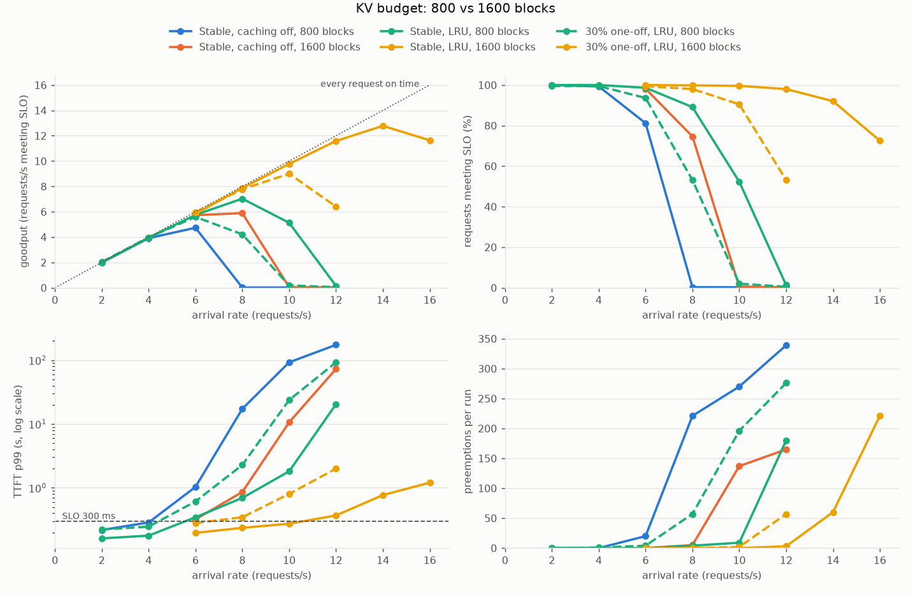
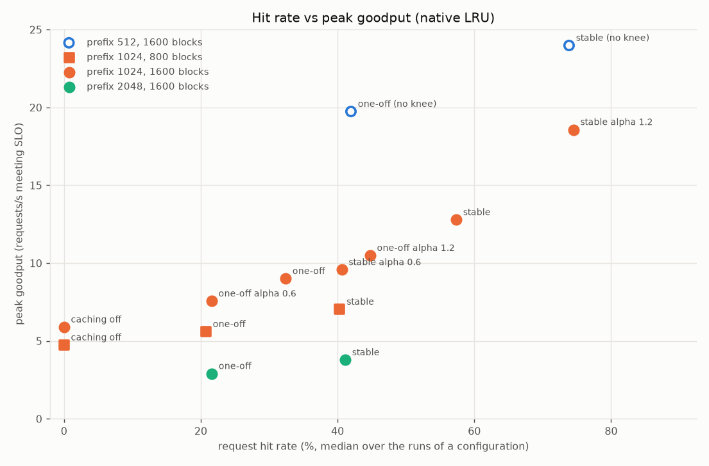

# Workload-Aware Prefix KV-Cache Management (COMS 6998 HPML, Fall 2026)

We study prefix-cache eviction in vLLM under a fixed KV-cache budget, and test whether a
workload-aware policy (reuse history + recency, optionally weighted by prefill cost)
improves goodput over vLLM's native LRU eviction.

## Status
- [x] Phase 1: vLLM running with a capped KV cache; prefix-cache smoke test passed
- [x] Phase 2: document pool, trace generator, replay client, metrics, server sampling,
      one-click runner, W&B upload
- [ ] Phase 3: SLO calibration (3.1), one-off traffic (3.2), load sweeps (3.3) and profiling (3.4)
      done; correctness baseline (3.5) and team checkpoint (3.6) open
- [ ] Phase 4: instrument vLLM's eviction path (block event log)
- [ ] Phase 5: offline simulator and policy selection
- [ ] Phase 6: implement the policy in vLLM, tests, overhead measurement
- [ ] Phase 7: held-out experiments and cross-model validation
- [ ] Phase 8: analysis, demo, report

## Environment (tested)
| Item | Value |
|---|---|
| GPU | NVIDIA RTX 4080 SUPER 32 GB (AutoDL), driver 580 |
| vLLM | 0.33.0 (tag `v0.33.0`, commit `4ba787e`), editable install of our fork, see below |
| PyTorch | 2.14.0+cu130 |
| Python | 3.12 (conda env `vllm`), plus matplotlib, pyyaml |
| Model | Qwen/Qwen2.5-3B-Instruct (Llama-3.2-3B-Instruct pending access) |

## Known issues
- If the system `nvcc` is older than CUDA 12.8, FlashInfer's sampler JIT build fails
  (`nvcc fatal: Unknown option '--compress-mode=size'`). Fix: `export VLLM_USE_FLASHINFER_SAMPLER=0`
  (the launch script and the experiment runner set it).
- On AutoDL: use `source /etc/network_turbo` for GitHub/Hugging Face, and
  `unset http_proxy https_proxy` before pip or local HTTP requests.
- W&B is not reachable from the AutoDL server (HTTP 403). Experiments save everything locally;
  `client/upload_wandb.py` uploads them from any machine that can reach W&B.
- Run only one vLLM server per GPU. The experiment runner stops any running server first.
- `bash: fork: Resource temporarily unavailable` means the container's process limit is full,
  usually leftover processes from earlier vLLM servers. Restart the instance; the runner now
  stops each server together with all of its child processes.

## vLLM from our fork
vLLM is our fork `jasper-sxy/vllm`, branch `prefix-evict` (created from tag `v0.33.0`, commit
`4ba787e`), checked out as the submodule `third_party/vllm` and installed in editable mode: Python
imports the source in `third_party/vllm/vllm`, so changes take effect when the server restarts.
The compiled CUDA/Rust parts come from the official 0.33.0 wheel (no local compilation).
The folder is `third_party/vllm` rather than `vllm` so that `import vllm` never picks up the
repository folder itself.

```bash
git clone --recurse-submodules https://github.com/jasper-sxy/hpml-prefix-cache.git
cd hpml-prefix-cache
pip download vllm==0.33.0 --no-deps -d /path/to/wheels           # official wheel: compiled parts
cd third_party/vllm
python -c "import tomllib; print(tomllib.load(open('pyproject.toml','rb'))['build-system']['requires'])"
pip install setuptools-rust setuptools-scm cmake ninja jinja2 wheel  # build requirements except torch
SETUPTOOLS_SCM_PRETEND_VERSION=0.33.0 VLLM_USE_PRECOMPILED=1 \
VLLM_PRECOMPILED_WHEEL_LOCATION=$(ls /path/to/wheels/vllm-0.33.0-*.whl) \
pip install -e . --no-deps --no-build-isolation
python -c "import vllm.v1.core.block_pool as bp; print(bp.__file__)"   # -> .../third_party/vllm/vllm/...
```
Roll back to the plain release with
`pip install --force-reinstall --no-deps /path/to/wheels/vllm-0.33.0-*.whl`.
The experiment runner records the fork commit (with `-dirty` for uncommitted changes) and the model
revision in each run's `experiment.json`.

## Pipeline
```
workload/build_doc_pool.py   -> workload/data/<model>/docs_{dev,test}.jsonl   WikiText-103 prefixes as token IDs
workload/make_trace.py       -> workload/traces/<model>/<trace>.jsonl          Zipf popularity, Poisson arrivals,
                                                                                popularity drift, one-off bursts
client/run_experiment.py configs/<exp>.yaml                                    on the GPU server; per run:
    restart vLLM (empty cache) -> client/replay.py -> client/metrics.py -> client/plot_run.py
    -> results/raw/<exp>/<label>_rep<k>_<time>/                               self-contained run directory
client/upload_wandb.py results/raw/<exp>                                       on any machine that reaches W&B
```
Generated data, traces, and raw results are not in git; they are reproducible from the scripts
and seeds. The document pool for Qwen2.5-3B (seed 0, 100 dev + 100 test, 2048 tokens) has
`token_digest` `0274c44d8d4065e1`.

## Quick start
```bash
# on the GPU server (conda env vllm)
python workload/build_doc_pool.py --model Qwen/Qwen2.5-3B-Instruct
python workload/make_trace.py                                    # stable popularity
python workload/make_trace.py --drift-at 0.5                     # re-rank documents halfway
python workload/make_trace.py --burst-at 0.5 --burst-size 20     # one-off burst halfway
python client/run_experiment.py configs/phase2_three_scenarios.yaml   # inside screen, ~20 min
python client/metrics.py results/raw/phase2_three_scenarios           # comparison table

# on a machine that reaches W&B, after copying results/raw/<exp> there
python client/upload_wandb.py results/raw/phase2_three_scenarios
```
Manual alternative: `bash scripts/start_server.sh` in one screen, then
`python client/replay.py --trace <trace>` and `python client/metrics.py <run_dir>`.

## Service-level objectives (frozen in Phase 3.1)
A request meets the SLO when **TTFT <= 300 ms and TPOT <= 35 ms**; goodput counts only such
requests. Both limits are about 3x the median latency with prefix caching off at low load
(1 request/s, 3 runs, `configs/phase3_calibration.yaml`): TTFT p50 96.6 ms, TPOT p50 11.0 ms.
At that load every request meets them (TTFT p99 about 202 ms, TPOT p99 14.3 ms), so misses at
higher load come from queueing or preemption. Goodput is computed afterwards from the
per-request records, so any run can be re-scored without re-running it. Phase 2 results used
the provisional 500 ms / 50 ms.

## Results

### Phase 1: prefix-cache smoke test
Qwen2.5-3B, 800 KV blocks (12,800 tokens), one ~2,300-token shared prefix.

| Request | Prefix cache ON | Prefix cache OFF |
|---|---|---|
| A: doc1 + q1 (cold) | 201.7 ms | 200.1 ms |
| B: doc1 + q2 (reuse) | 59.4 ms | 189.2 ms |
| C: doc2 + q1 (cold) | 186.2 ms | 186.4 ms |
| Prefix-cache hit tokens | 2,288 (143 full blocks) | 0 |

### Phase 2: native LRU on three scenarios
Qwen2.5-3B, 800 KV blocks (12,800 tokens = 12 prefixes of 1,024 tokens), 80 documents,
Zipf alpha 0.9, 2 requests/s for 300 s, 64 output tokens, provisional SLO TTFT 500 ms /
TPOT 50 ms, one run each. Config: `configs/phase2_three_scenarios.yaml`.

| Scenario | Requests | Request hit rate | Ideal (infinite cache) | TTFT p50 | TTFT p99 | SLO met | Goodput | Preemptions |
|---|---|---|---|---|---|---|---|---|
| stable | 595 | 43.5% | 87.2% | 92.9 ms | 166.3 ms | 100.0% | 1.99 req/s | 0 |
| drift (re-rank at 150 s) | 595 | 42.9% | 87.2% | 93.5 ms | 162.5 ms | 100.0% | 1.99 req/s | 0 |
| burst (20 one-off docs at 150 s) | 615 | 41.1% | 84.4% | 93.9 ms | 242.5 ms | 99.2% | 2.04 req/s | 1 |

Findings:
- LRU reuses about half of the requests that could reuse a prefix, in all three scenarios.
- A hit cuts TTFT p50 from 97 ms to 42 ms (stable run). At 2 requests/s almost every request
  meets the provisional SLO, so goodput equals throughput; Phase 3 raises the load.
- Drift and one-off bursts barely change LRU's hit rate: with room for 12 prefixes, LRU only
  remembers the last 10-15 s of traffic, so it loses hot prefixes all the time, not just at events.
- The burst caused one preemption and about 5 SLO misses: 800 blocks hold only about 11
  concurrent requests. Phase 3 must size the KV budget together with the load so that
  preemption does not hide the effect of eviction.
- Runs are deterministic: the automated runner reproduced the manual runs' hit rates exactly
  (0.4353 stable, 0.4286 drift), and so did the editable install of our fork
  (`configs/fork_check.yaml`: hit rate 0.4353, TTFT p50 93.8 ms vs. 92.9 ms).

### Phase 3.1: SLO calibration and measurement cross-check
Prefix caching off, 800 KV blocks, 1 request/s for 300 s, 64 output tokens. Our client replays
the WikiText trace (token-ID prompts, ~1,042 tokens); `vllm bench serve` sends 300 random
1,040-token text prompts at the same rate.

| Metric | Our client (3 runs) | vllm bench serve |
|---|---|---|
| TTFT p50 | 96.6-96.7 ms | 111.1 ms |
| TTFT p99 | 201.6-204.5 ms | 173.3 ms |
| TPOT p50 | 11.0 ms | 10.5 ms |
| TPOT p99 | 14.3 ms | 14.2 ms |
| Requests meeting SLO | 100% | 100% |

The three runs agree within 0.1%. Per-token metrics agree with vLLM's own benchmark within 5%.
Its median TTFT is 15% higher; it sends text that the server must tokenize first (random-token
text may also re-tokenize to more than 1,040 tokens), while our client sends token IDs.

### Phase 3.2: continuous one-off traffic
800 KV blocks, 2 requests/s, native LRU (`configs/phase3_oneoff_check.yaml`). With
`--oneoff-frac f`, each arrival asks, with probability f, about a document that is never asked
about again (2,000 dev one-off documents, same rate overall). One-off requests never hit, and
they push regular prefixes out: the hit rate of regular requests drops from 43.5% (f = 0) to
29.2% (f = 0.15) and 29.0% (f = 0.3). We use f = 0.3 as the main one-off scenario.

### Phase 3.3: load sweeps with native LRU
108 runs, one per point, dev documents, 300 s each. Main budget 1600 KV blocks (25,600 tokens,
about 24 prefixes of 1,024 tokens); 800 blocks as the tight-memory case. Stable-family curves
run at 6-16 requests/s, 30%-one-off curves at 6-12 (configs `phase3_sweep_*`,
`phase3_scenarios_b1600`, `phase3_sensitivity_b1600*`; tables in `results/tables/phase3/`).
"Busy" = highest rate where LRU still meets the SLO for at least 95% of requests; "near
collapse" = the first rate below 95%. These are the proposed operating points for Phase 7.

| Configuration (1600 blocks unless noted) | Request hit rate | Peak goodput (req/s @ rate) | Busy / near collapse (req/s) |
|---|---|---|---|
| caching off | 0 | 5.9 @ 8 | - |
| stable | 56-58% | 12.8 @ 14 | 12 / 14 |
| 30% one-off | 31-32% | 9.0 @ 10 | 8 / 10 |
| drift (re-rank at 150 s) | 56-59% | 12.7 @ 14 | 12 / 14 |
| burst (20 one-off docs at 150 s) | 55-58% | 12.2 @ 14 | 10 / 12 |
| drift + 30% one-off | 31-32% | 9.0 @ 10 | 8 / 10 |
| stable, alpha 0.6 | 40-41% | 9.6 @ 10 | 10 / 12 |
| stable, alpha 1.2 | 73-75% | 18.6 @ 20 | 18 / 20 |
| 30% one-off, alpha 0.6 | 21-22% | 7.6 @ 8 | 8 / 10 |
| 30% one-off, alpha 1.2 | 44-45% | 10.5 @ 12 | 10 / 12 |
| stable, prefix 512 | 72-75% | 24.0 @ 24 (no knee) | 24 / - |
| 30% one-off, prefix 512 | 41-42% | 19.7 @ 20 (no knee) | 20 / - |
| stable, prefix 2048 | 41-43% | 3.8 @ 5 | 2 / 3 |
| 30% one-off, prefix 2048 | 20-23% | 2.9 @ 4 | - / 2 |
| 800 blocks: caching off | 0 | 4.7 @ 6 | - |
| 800 blocks: stable | 40-43% | 7.0 @ 8 | 6 / 8 |
| 800 blocks: 30% one-off | 20-21% | 5.6 @ 6 | 4 / 6 |




More figures: [`scenarios_b1600.png`](results/figures/phase3/scenarios_b1600.png),
[`alpha_b1600.png`](results/figures/phase3/alpha_b1600.png), [`prefix_b1600.png`](results/figures/phase3/prefix_b1600.png),
timelines of drift and burst at 12 requests/s ([`timeline_drift_r12.png`](results/figures/phase3/timeline_drift_r12.png),
[`timeline_burst_r12.png`](results/figures/phase3/timeline_burst_r12.png)).

Findings:
- Prefix caching more than doubles peak goodput at 1600 blocks (5.9 -> 12.8 req/s) and adds 49%
  at 800 blocks (4.7 -> 7.0): more memory pays off mainly through more cached prefixes.
- 30% one-off traffic cuts LRU's peak by 30% (12.8 -> 9.0); the hit rate of regular requests
  falls from about 57% to about 45%. This is the loss a workload-aware policy can try to recover.
- Drift does not hurt LRU: its hit rate is the same before and after the re-rank (56-59%),
  because new hot documents are cached within seconds. Drift is therefore a guardrail for the
  new policy, not a weakness of LRU. A 20-request burst costs 3-6% of goodput near the knee,
  mostly through the extra prefill load (hits slow down as well), not through eviction.
- For 1024-token prefixes at 1600 blocks, peak goodput rises monotonically with the hit rate;
  goodput ~ 1 / (0.0142 + 0.155 (1 - h)) fits all seven configurations within 7%.
- Prefix 512 shows no knee up to 24 (stable) and 20 (one-off) requests/s. Prefix 2048 reaches
  the knee at 2-3 requests/s, partly because the TTFT SLO was calibrated with 1,024-token
  prompts (a 2,048-token cold prefill alone is close to 300 ms); to be settled at checkpoint 3.6.

### Phase 3.4: profiling
Details, scripts and caveats: [`profiling/README.md`](profiling/README.md).
- Request time (vLLM /metrics): a hit cuts the mean prefill from 89 to 54 ms at low load; near
  the knee, SLO misses come mostly from queueing (queue p99 about 600 ms).
- Cost of one engine step (Nsight Systems, 12 req/s): GPU time = 9.6 ms + 61.5 ms per 1,000
  prefill tokens + 0.17 ms per decoding request (R^2 = 1.00); GEMMs are about 82% of kernel time,
  attention about 13%.
- Decode is memory-bound at about 87% of DRAM bandwidth, prefill compute-bound at 80-90% of the
  BF16 peak: little is left to gain per token, so avoiding recomputation is the main lever.
- At 12 req/s the GPU is busy about 98% of the time; the knee near 14 req/s is GPU throughput.
  One prefix miss costs about 64 ms of GPU time, and every request decoding in that step waits.

## Repository layout
| Path | Content | Phase |
|---|---|---|
| `scripts/` | server launch script, prefix-cache smoke test | 1 |
| `workload/` | document pool, question templates, trace generator | 2 |
| `client/` | replay client, metrics, timeline plot, experiment runner, W&B uploader | 2 |
| `configs/` | experiment configs (YAML) | 2+ |
| `profiling/` | profiling scripts and results ([README](profiling/README.md)) | 3 |
| `eval/` | correctness and quality checks | 3, 7 |
| `sim/` | offline eviction simulator | 5 |
| `results/` | summary tables and figures (raw runs are not in git) | 3+ |
| `third_party/vllm/` | our vLLM fork (submodule, branch `prefix-evict` from v0.33.0), installed editable | 4, 6 |

## W&B
Project `hpml-prefix-cache` (personal workspace for now; pass `--entity <team>` to
`upload_wandb.py` once a team exists). Each run is grouped by experiment name and carries the
full config, summary metrics, server time series, per-window hit rate, the request table, and
the timeline plot.

## Contributions
To be filled in by each member.
